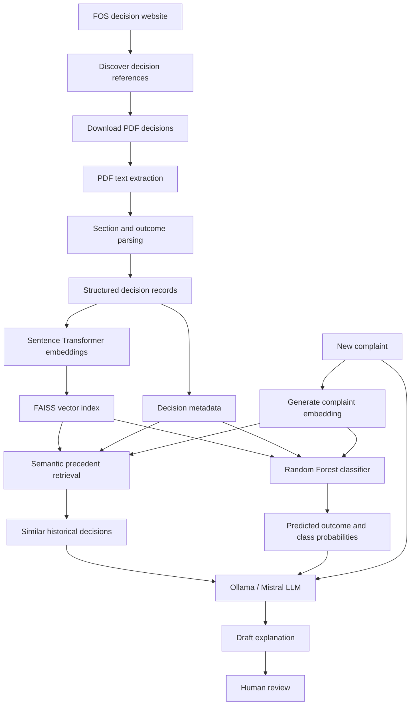

# ombudsman-decision-classification-rag
AI-powered Financial Ombudsman Decision Intelligence system combining Machine Learning classification (Random Forest) and Retrieval-Augmented Generation (RAG) using semantic search (FAISS) and LLM-based explanations.
# Financial Ombudsman Decision Intelligence

**An AI-assisted decision analysis system for exploring historical Financial Ombudsman Service (FOS) decisions, retrieving relevant precedents, predicting likely complaint outcomes, and drafting evidence-informed explanations.**

The full project is intended to scale to approximately **11,000 historical FOS decision PDFs**. The current repository contains a **50-PDF demonstration dataset** used to develop and demonstrate the workflow. The 50-document version should not be mistaken for a completed implementation over all 11,000 documents.

> **Project status and scope:** The repository demonstrates the end-to-end technical workflow on 50 PDFs. Processing, indexing, and training across the full target corpus of approximately 11,000 PDFs remain the intended full-scale scope.

---

## 1. The problem I wanted to solve

Financial Ombudsman decisions contain valuable historical information about how different types of financial complaints were considered and resolved. However, reviewing a large collection of PDF decisions manually can be time-consuming. It can also be difficult to find earlier decisions that are relevant to a new complaint and compare the reasoning used in those cases.

The project explores how document processing, semantic search, machine learning, and a large language model can be combined to make this information easier to search and analyse.

## 2. What I built

I developed a Python-based workflow that turns historical FOS decision PDFs into structured, searchable decision records and uses those records to analyse a new complaint.

The system brings together four main capabilities:

1. **Document ingestion and extraction** – discovers decision references, downloads PDFs, extracts text, and identifies key decision sections and outcome labels.
2. **Semantic precedent search** – converts complaint text into embeddings and uses FAISS to retrieve similar historical decisions.
3. **Outcome classification** – uses a Random Forest classifier to estimate whether a complaint may be upheld, not upheld, or partly upheld.
4. **LLM-assisted explanation drafting** – provides the complaint, predicted outcome, and retrieved precedent summaries to a locally hosted Mistral model through Ollama to draft an explanation for human review.

The aim is to support faster exploration of historical decisions. The system is a decision-support workflow: its predictions and generated text are not official FOS decisions and must be reviewed by a person.

## 3. End-to-end workflow

The workflow has two connected paths: preparing the historical decision knowledge base and analysing a new complaint.

### A. Preparing the historical decision knowledge base

- Discover decision references for a selected date range.
- Download the corresponding PDF decisions.
- Extract PDF text and parse key sections using `pdfplumber` and rule-based patterns.
- Capture the complaint, what happened, the ombudsman's reasoning/final decision, reference number, and outcome.
- Track processed documents through a manifest to support incremental ingestion.
- Send documents with parsing warnings to a review queue.
- Generate sentence embeddings and store them in a FAISS vector index alongside decision metadata.
- Use the indexed records and outcome labels to train the Random Forest classifier.

### B. Analysing a new complaint

- Accept the complaint description and details of what happened.
- Generate an embedding using the same Sentence Transformer model used for historical decisions.
- Run the complaint through the trained classifier to obtain a predicted outcome and class probabilities.
- Search the FAISS index for similar historical decisions.
- Pass the complaint, prediction, and retrieved precedent summaries to the Mistral model running locally through Ollama.
- Generate draft sections titled **“What I've decided - and why”** and **“My final decision”**.
- Run a basic numeric consistency check and present the output for human assessment.

### Architecture



## 4. Main technical components

| Component | Implementation | Purpose |
|---|---|---|
| Reference discovery | Requests, Playwright | Find FOS decision references over a date range |
| PDF collection | Python download scripts | Download decision documents and track download status |
| PDF extraction | `pdfplumber` | Extract text from decision PDFs |
| Section parsing | Python, regular expressions | Identify decision sections, reference numbers, and outcomes |
| Incremental ingestion | JSON manifest, JSONL | Avoid reprocessing known documents and track records needing review |
| Text representation | Sentence Transformers, `all-MiniLM-L6-v2` | Convert complaint text into vector embeddings |
| Similarity search | FAISS, NumPy | Retrieve semantically similar historical decisions |
| Outcome prediction | Scikit-learn Random Forest | Classify complaint outcomes |
| Model persistence | Joblib | Save and load the trained classifier and label encoder |
| Explanation generation | Ollama, Mistral | Draft explanations using complaint context and retrieved precedents |

## 5. Key engineering decisions and implementation details

### Incremental document ingestion

The ingestion process uses a manifest to record processed PDFs. This helps avoid repeatedly parsing the same files when new documents are added. Documents that produce parsing warnings are recorded separately in a review queue rather than silently treated as clean records.

### Semantic retrieval with FAISS

The project uses `all-MiniLM-L6-v2` to embed the combined `complaint` and `what_happened` text. The vectors are L2-normalised and stored in a FAISS `IndexFlatIP` index. With normalised vectors, inner-product search is equivalent to cosine similarity.

The vector index is stored separately from its metadata. The metadata records are kept in the same order as the corresponding vectors so that retrieved vector positions can be mapped back to decision details.

### Machine-learning-based outcome prediction

The classifier is a Scikit-learn Random Forest configured with 200 estimators and balanced class weights. The training script creates a train/test split, reports holdout accuracy and a classification report, then trains the final model on the available indexed dataset and saves it with Joblib.

The available demonstration dataset is small and imbalanced. Its metrics and predicted probabilities should therefore be treated as preliminary workflow checks, not proof of performance on the intended full dataset.

### LLM-assisted drafting with retrieved context

The explanation-generation stage uses a locally hosted Mistral model through Ollama. It supplies the model with the new complaint, the classifier output, and summaries of similar historical decisions retrieved from FAISS. The model drafts two explanation sections for human review.

A post-generation check flags monetary figures and standalone numbers that appear in the generated text but not in the supplied context. This is a limited consistency check; it is not a comprehensive hallucination detector or legal validation mechanism.

### Human review and confidence routing

The current workflow uses a classifier probability threshold of `0.65` as a basic routing heuristic and a similarity cutoff of `0.35` for retrieved results. These are implementation-level thresholds, not validated production policies. Predicted probabilities have not been demonstrated to be calibrated, and semantic similarity does not establish that two complaints are legally or factually equivalent.

## 6. Dataset scope and current implementation status

| Scope | Details |
|---|---|
| Full-project target | Approximately 11,000 historical FOS decision PDFs |
| Current repository demonstration | 50 PDF documents |
| Parsed records in the supplied snapshot | 50 |
| Records in the review queue | 5 |
| Records represented in the FAISS index | 45 |

The indexed demonstration records have the following outcome distribution:

| Outcome | Indexed records |
|---|---:|
| Not upheld | 32 |
| Upheld | 10 |
| Partly upheld | 3 |
| **Total** | **45** |

These figures describe only the supplied 50-PDF repository snapshot. They are not statistics for the intended 11,000-document corpus. The current repository demonstrates the pipeline; it does not establish that all 11,000 documents have already been processed, indexed, or used to train the model.

## 7. Technology stack

- **Language:** Python
- **Data collection:** Requests, Playwright
- **PDF processing:** pdfplumber
- **Text processing:** Regular expressions
- **Embeddings:** Sentence Transformers (`all-MiniLM-L6-v2`)
- **Vector database/index:** FAISS
- **Machine learning:** Scikit-learn, Random Forest
- **Numerical processing:** NumPy
- **Model persistence:** Joblib
- **LLM inference:** Ollama, Mistral
- **Data formats:** JSON, JSONL

## 8. Repository structure

```text
financial-ombudsman-decision-intelligence/
│
├── discover_references.py       # Discover decision references by date range
├── fetchpdf.py                  # Browser-assisted reference collection and PDF download
├── download_pdfs.py             # Download PDFs from a reference list
├── parse_sections.py            # Extract sections, reference and outcome from PDFs
├── batch_ingest.py              # Incremental PDF parsing and review queue management
├── embed_and_index.py           # Generate embeddings and build/update FAISS index
├── search_similar.py             # Search for similar historical decisions
├── train_classifier.py          # Train and evaluate the Random Forest classifier
├── predict.py                    # Predict outcome and retrieve similar decisions
├── generate_explanation.py      # Generate a draft explanation using Ollama
│
├── pdfs/                         # Demonstration decision PDFs
├── parsed/
│   ├── all_decisions.jsonl       # Parsed decisions (one JSON record per line)
│   └── review_queue.jsonl        # Records requiring review
│
├── index/
│   ├── faiss.index               # FAISS vector index
│   ├── metadata.jsonl            # Metadata aligned with FAISS vector positions
│   └── embed_manifest.json       # Tracks documents already embedded
│
├── model/
│   ├── classifier.joblib         # Trained Random Forest classifier
│   └── label_encoder.joblib      # Outcome label encoder
│
├── manifest.json                 # PDF parsing manifest
└── README.md
```

## 9. Limitations and next steps

The current 50-document demonstration is useful for showing the system workflow, but it is not sufficient to establish robust predictive performance. The following work is important before treating the system as a full-scale operational solution:

- Extend and validate ingestion for the target corpus of approximately 11,000 historical PDFs.
- Improve coverage and balance across outcome classes.
- Evaluate with a representative, independent test set and class-wise metrics.
- Calibrate classifier probabilities before using confidence-based routing.
- Evaluate retrieval quality with reviewed examples; similarity alone does not prove case equivalence.
- Improve parsing for scanned PDFs, unusual layouts, missing sections, and extraction failures.
- Validate generated explanations against original source decisions and trace supporting statements to their source documents.
- Strengthen automated testing, structured logging, exception handling, monitoring, and dependency/version management.
- Define privacy, retention, access-control, and responsible-use requirements for complaint data.

The current repository is a Python command-line workflow. A web application, REST API, authentication layer, deployment pipeline, and production monitoring are not included in the demonstrated implementation.

## 10. Running the project

The following instructions are included for technical reviewers who want to explore the repository. The README is primarily intended to explain the project design and implementation; running the code is optional for understanding the work.

### Prerequisites

- Python 3.10 or later
- pip
- Internet access for collecting source documents and downloading the embedding model on first use
- Ollama installed locally for explanation generation
- Sufficient system memory to run the selected local LLM

### Install

```bash
git clone <your-repository-url>
cd <repository-folder>

python -m venv .venv
```

Activate the environment:

**Windows**
```bash
.venv\Scripts\activate
```

**macOS / Linux**
```bash
source .venv/bin/activate
```

Install the dependencies:

```bash
pip install requests playwright pdfplumber sentence-transformers faiss-cpu numpy scikit-learn joblib
```

For browser-based collection:

```bash
playwright install chromium
```

Install Ollama from [ollama.com](https://ollama.com/) and pull the model:

```bash
ollama pull mistral:7b-instruct
```

Ollama's local API is used at:

```text
http://localhost:11434/api/generate
```

### Run the pipeline

Run commands from the repository root. The collection scripts depend on the current behaviour of the FOS website; review and configure the discovery method before using them.

**1. Discover references**

```bash
python discover_references.py --mode browser --date_from 2025-07-01 --date_to 2026-07-01
```

The command writes `references.json` by default. For API mode, configure `API_ENDPOINT` and the response-field mapping in `discover_references.py` after inspecting the website's network request.

**2. Download PDFs**

```bash
python download_pdfs.py --references references.json --pdf_dir ./pdfs
```

Alternatively, use the browser-assisted workflow:

```bash
python fetchpdf.py --pdf_dir ./pdfs --max_pages 500
```

**3. Parse documents**

```bash
python batch_ingest.py --pdf_dir ./pdfs --out_dir ./parsed --manifest ./manifest.json
```

Review `parsed/review_queue.jsonl` and inspect extracted records before indexing and training.

**4. Build or update the vector index**

```bash
python embed_and_index.py --decisions ./parsed/all_decisions.jsonl --index_dir ./index
```

To rebuild it:

```bash
python embed_and_index.py --decisions ./parsed/all_decisions.jsonl --index_dir ./index --rebuild
```

Rebuilding deletes the existing FAISS index, metadata file, and embedding manifest in the target index directory before recreating them.

**5. Search similar decisions**

```bash
python search_similar.py --index_dir ./index --query "The bank increased my credit limit without checking affordability" --top_k 5
```

**6. Train the classifier**

```bash
python train_classifier.py --index_dir ./index --model_out ./model --test_size 0.2
```

**7. Predict an outcome**

```bash
python predict.py --complaint "The bank increased my credit card limit without checking affordability." --what_happened "I struggled to make the higher monthly repayments." --index_dir ./index --model_dir ./model --top_k 5
```

**8. Generate a draft explanation**

Ensure Ollama is running and the model is available:

```bash
ollama serve
```

Then run:

```bash
python generate_explanation.py --complaint "The bank increased my credit card limit without checking affordability." --what_happened "I struggled to make the higher monthly repayments." --index_dir ./index --model_dir ./model --top_k 5 --model mistral:7b-instruct
```

The output includes the classifier prediction, retrieved precedents, generated explanation, and numeric consistency-check result.

---


